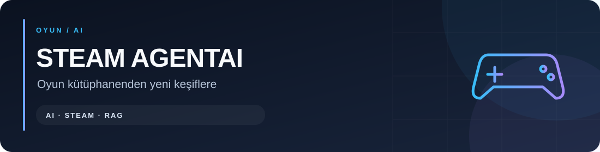
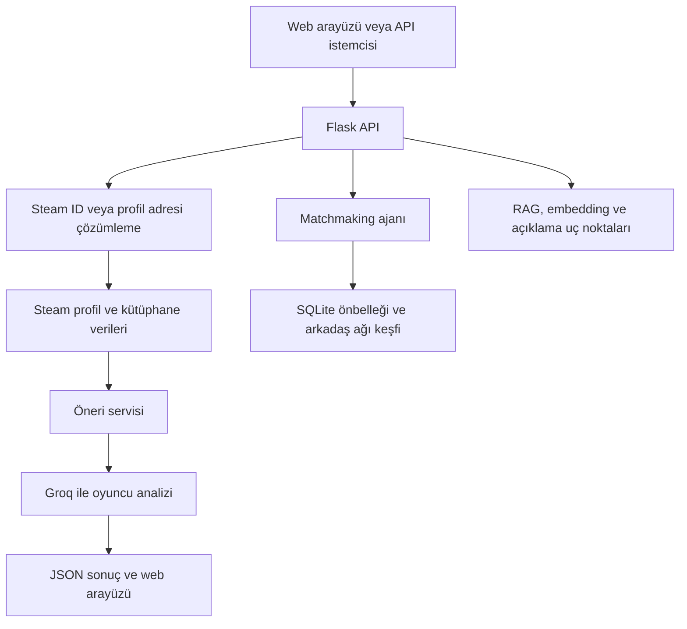

# Steam AgentAI



[](https://github.com/symNistaken/steam-agentai/actions/workflows/checks.yml)
[](https://www.python.org/downloads/)

[](LICENSE)

**Steam oyun kütüphanenden oyuncu profilini çıkar, AI destekli oyun önerileri al ve benzer oyuncuları keşfet.**

Steam AgentAI; Steam Web API verilerini, Groq üzerinden dil modeli analizini ve Python/Flask tabanlı bir web arayüzünü bir araya getirir. Projede ayrıca çoklu ajan altyapısı, embedding tabanlı benzerlik, RAG bağlamı ve öneri açıklama bileşenleri bulunur.

> Bu proje Valve, Steam veya Groq tarafından geliştirilmiş ya da onaylanmış değildir. Steam ve ilgili markalar sahiplerine aittir.

## İçindekiler

- [Özellikler](#özellikler)
- [Nasıl çalışır?](#nasıl-çalışır)
- [Teknolojiler](#teknolojiler)
- [Kurulum](#kurulum)
- [Kullanım](#kullanım)
- [Yapılandırma](#yapılandırma)
- [API rehberi](#api-rehberi)
- [Proje yapısı](#proje-yapısı)
- [Veri ve gizlilik](#veri-ve-gizlilik)
- [Testler](#testler)
- [Sorun giderme](#sorun-giderme)
- [Mevcut sınırlar](#mevcut-sınırlar)
- [Katkıda bulunma](#katkıda-bulunma)
- [Lisans](#lisans)

## Özellikler

| Bileşen | İşlev |
| --- | --- |
| Profil analizi | Steam profilini, kütüphaneyi ve oynama sürelerini işler. |
| AI önerileri | Oyuncu verilerinden Groq ile oyun önerileri ve gerekçeler üretir. |
| Web arayüzü | Türkçe arayüzde profil, kütüphane ve öneri sonuçlarını gösterir. |
| Matchmaking | Önbellekteki oyuncuları ve arkadaş ağı keşfini kullanarak uyumlu oyuncular arar. |
| Semantik benzerlik | Oyun metinlerini embedding vektörlerine dönüştürerek karşılaştırır. |
| RAG bağlamı | Benzer oyunları vektör indeksinden getirerek bağlam oluşturur. |
| Öneri açıklaması | Tür, oyun tarzı, zorluk ve süre gibi özelliklere dayalı açıklamalar üretir. |
| Ajan altyapısı | Profil, retrieval, ranker ve matchmaking ajanları ile koordinasyon kodunu içerir. |

## Nasıl çalışır?

Ana profil analizi akışı:



`/api/analyze` ve `/api/agentic/recommend`, mevcut sürümde `AgenticRecommendationService.analyze_profile()` üzerinden çalışır. Dört ajan başlangıçta kaydedilir; ancak bu iki uç nokta her istekte tam `Orchestrator` zincirini yürütmez. Matchmaking kendi ajanını çalıştırır; RAG ve açıklama özellikleri ayrı uç noktalarda da kullanılabilir.

## Teknolojiler

| Alan | Teknoloji |
| --- | --- |
| Dil ve web | Python 3.10, Flask |
| AI servisi | Groq SDK; mevcut model: `llama-3.3-70b-versatile` |
| Steam erişimi | Steam Web API, requests, aiohttp |
| Veri modelleri | Pydantic |
| Embedding | SentenceTransformers, Transformers, PyTorch |
| Vektör arama | FAISS; paket yoksa NumPy tabanlı alternatif |
| Saklama | SQLite ve dosya tabanlı saklama bileşenleri |
| Arayüz | HTML, CSS ve JavaScript |
| Otomatik kontrol | GitHub Actions, compileall, unittest |

Paket sürümleri [requirements.txt](requirements.txt) içinde sabitlenmiştir. Bu dosyada LangChain, Redis, LIME ve SHAP da bulunur; ana uygulama kodu bunların tamamını aktif olarak kullanmaz. Açıklama bileşeni şu an özellik tabanlı hesaplamalar yapar; gerçek LIME/SHAP analizi olarak yorumlanmamalıdır.

## Kurulum

### Gereksinimler

- Python **3.10** ve Git.
- Steam Web API anahtarı.
- Groq API anahtarı ve yapılandırılmış modele erişim.
- Paket kurulumu, Steam/Groq istekleri ve ilk model indirmesi için internet bağlantısı.

GPU zorunlu değildir. Embedding modeli yüklenirken indirme, disk alanı ve bellek gerekir; süre kullanılan sisteme bağlıdır.

### 1. Depoyu klonla

```bash
git clone https://github.com/symNistaken/steam-agentai.git
cd steam-agentai
```

### 2. Sanal ortam ve paketler

**Windows PowerShell:**

```powershell
py -3.10 -m venv .venv
.\.venv\Scripts\python.exe -m pip install --upgrade pip
.\.venv\Scripts\python.exe -m pip install -r requirements.txt
Copy-Item .env.example .env
```

Bu komutlar sanal ortamı etkinleştirmeden çalışır; PowerShell script yürütme ayarını değiştirmen gerekmez.

**Linux/macOS:**

```bash
python3.10 -m venv .venv
.venv/bin/python -m pip install --upgrade pip
.venv/bin/python -m pip install -r requirements.txt
cp .env.example .env
```

### 3. API anahtarları

[Steam Web API](https://steamcommunity.com/dev/apikey) ve [Groq Console](https://console.groq.com/keys) üzerinden kendi anahtarlarını al. `.env` dosyasını düzenle:

```dotenv
STEAM_API_KEY=YOUR_STEAM_API_KEY
GROQ_API_KEY=YOUR_GROQ_API_KEY
FLASK_DEBUG=false
FLASK_HOST=127.0.0.1
```

Örnekteki anahtarlar yer tutucudur. Gerçek anahtarları `.env` içinde tut; issue, ekran görüntüsü veya commit içine koyma. Servislerin erişim kuralları ve kullanım kotaları ayrıca geçerlidir.

### 4. Başlat

Windows:

```powershell
.\.venv\Scripts\python.exe app.py
```

Linux/macOS:

```bash
.venv/bin/python app.py
```

Tarayıcıda **[http://localhost:5000](http://localhost:5000)** adresini aç. Terminali açık tut; sunucuyu durdurmak için `Ctrl+C` kullan.

## Kullanım

1. Web arayüzüne Steam ID64, Steam profil URL'si veya çözümlenebilen özel profil adını gir.
2. Analizi başlat. Profil ve kütüphane görünürlüğü Steam'den alınabilecek verileri belirler.
3. Oyuncu bilgilerini, oynama sürelerini ve öneri gerekçelerini incele.
4. Oyuncu eşleştirmesini kullanarak benzer kütüphanelere sahip oyuncuları ara.

Groq çıktıları her istekte değişebilir. Öneri gerekçeleri, oyun adları ve mağaza eşleşmeleri kesin doğruluk garantisi taşımaz.

## Yapılandırma

| Ayar | Konum | Davranış |
| --- | --- | --- |
| `STEAM_API_KEY` | `.env` | Steam Web API anahtarı |
| `GROQ_API_KEY` | `.env` | Groq anahtarı |
| `FLASK_DEBUG` | `.env` | Örnek dosyada `false`; değişken verilmezse kod varsayılanı `true` |
| `FLASK_HOST` | `.env` | Varsayılan `127.0.0.1` |
| `FLASK_PORT` | `config.py` | Sabit `5000`; `.env` üzerinden okunmaz |
| `LLM_MODEL` | `config.py` | Groq model adı |
| `LLM_PROVIDER` | `config.py` | Mevcut ana servis Groq kullanır |
| Embedding modeli | `core/embeddings.py` | Varsayılan `all-MiniLM-L6-v2` |

`config.py` içinde Ollama ayarları da vardır; ana öneri servisinde tamamlanmış bir sağlayıcı geçişi bulunmadığından yalnızca `LLM_PROVIDER` değerini değiştirmek yeterli değildir.

## API rehberi

Temel adres: `http://localhost:5000`. POST isteklerinde `Content-Type: application/json` kullan.

| Yol | Yöntem | Gövde alanları | İşlev |
| --- | --- | --- | --- |
| `/` | GET | — | Web arayüzü |
| `/api/analyze` | POST | `steam_input`, isteğe bağlı `use_agentic` | Profil ve kütüphane analizi |
| `/api/agentic/recommend` | POST | `steam_id` | Öneri servisi |
| `/api/health` | GET | — | Ajan, araç ve veritabanı durumu |
| `/api/db/stats` | GET | — | Önbellek istatistikleri |
| `/api/matchmaking` | POST | `steam_id` | Oyuncu eşleştirme |
| `/api/rag/context` | POST | `steam_id`, isteğe bağlı `max_context` | Benzer oyun bağlamı |
| `/api/xai/explain` | POST | `steam_id`, `game_name`, isteğe bağlı `recommendation_score` | Özellik tabanlı açıklama |
| `/api/embeddings/similarity` | POST | `game1_name`, `game2_name` | İki oyun adının metin benzerliği |

`use_agentic` varsayılan olarak `true`; `max_context` varsayılan `15` ve `1–50` aralığına sınırlandırılır. `recommendation_score` varsayılan `0.7`.

`/api/agentic/recommend` mevcut kodda `max_recommendations` ve `include_matchmaking` alanlarını okumaz. Matchmaking için ayrı uç noktayı kullan.

### PowerShell örnekleri

Sağlık kontrolü:

```powershell
Invoke-RestMethod -Uri 'http://localhost:5000/api/health'
```

Profil analizi:

```powershell
$payload = @{ steam_input = 'YOUR_STEAM_ID64'; use_agentic = $true } | ConvertTo-Json
Invoke-RestMethod -Uri 'http://localhost:5000/api/analyze' -Method Post -ContentType 'application/json' -Body $payload
```

Oyuncu eşleştirme:

```powershell
$payload = @{ steam_id = 'YOUR_STEAM_ID64' } | ConvertTo-Json
Invoke-RestMethod -Uri 'http://localhost:5000/api/matchmaking' -Method Post -ContentType 'application/json' -Body $payload
```

### Bash/cURL örnekleri

```bash
curl http://localhost:5000/api/health

curl -X POST http://localhost:5000/api/agentic/recommend \
  -H 'Content-Type: application/json' \
  -d '{"steam_id":"YOUR_STEAM_ID64"}'

curl -X POST http://localhost:5000/api/rag/context \
  -H 'Content-Type: application/json' \
  -d '{"steam_id":"YOUR_STEAM_ID64","max_context":10}'

curl -X POST http://localhost:5000/api/xai/explain \
  -H 'Content-Type: application/json' \
  -d '{"steam_id":"YOUR_STEAM_ID64","game_name":"Elden Ring","recommendation_score":0.85}'

curl -X POST http://localhost:5000/api/embeddings/similarity \
  -H 'Content-Type: application/json' \
  -d '{"game1_name":"Dark Souls 3","game2_name":"Elden Ring"}'
```

Örneklerdeki `YOUR_STEAM_ID64` değerini kendi ID'nle değiştir. Başarılı profil analizi `success`, `player`, `stats`, `top_games`, `library` ve `analysis` alanlarını döndürür. Sağlık uç noktası `status`, `agents_registered`, `tools_registered` ve `database` alanlarını içerir.

Eksik veya çözümlenemeyen profil girdileri genellikle HTTP `400`; beklenmeyen sunucu hataları `500` döndürür. Hata yanıtlarında `success: false` ve `error` bulunur. `/api/health` sonucunun başarılı olması, canlı Steam/Groq çağrılarının veya tüm AI bileşenlerinin başarıyla çalıştığını tek başına kanıtlamaz.

## Proje yapısı

```text
steam-agentai/
├── app.py                   # Flask ve API uç noktaları
├── config.py                # Ortam ve model ayarları
├── init_app.py              # Ajan/araç kaydı
├── orchestrator.py          # Ajan koordinasyon altyapısı
├── agents/                  # Profil, retrieval, ranker, matchmaking
├── core/                    # Embedding, vektör arama, açıklama
├── services/                # Steam, Groq, RAG ve öneri servisleri
├── schemas/                 # Pydantic veri modelleri
├── tools/                   # Steam araçları ve şemaları
├── database/                # SQLite ve dosya saklama kodu
├── templates/               # Web arayüzü
├── backups/                 # Önceki arayüz yedeği
├── docs/                    # Önceki README
├── tests/                   # Bağımsız SQLite testleri
├── .github/workflows/       # GitHub Actions
├── .env.example             # Anahtarsız ortam şablonu
├── requirements.txt         # Sabitlenmiş bağımlılıklar
└── LICENSE                  # MIT lisansı
```

## Veri ve gizlilik

- `.env`, `.venv/`, `venv/`, Python önbelleği ve kişisel editör ayarları Git tarafından yok sayılır.
- `database/matchmaking_cache.db` kullanıcı önbelleğidir; depoya yüklenmez. Şeması ilk kullanımda oluşturulur.
- `data/` dosya tabanlı çalışma verileridir; depoya yüklenmez.
- SQLite önbelleği oynanmamış oyunları ayıklar ve oyuncu başına en çok oynanan 50 oyunu saklar.
- Yeni klonda hazır oyuncu havuzu bulunmaz; eşleştirme sonuçları görünür profillere ve keşfedilen oyunculara bağlıdır.
- Profil adı ve oynanan oyunlar gibi veriler AI analizi için Groq'a gönderilebilir. Profil sorguları uygulama terminalinde de görünebilir.

Kullanılan üçüncü taraf hizmetlerin koşullarını ve veri işleme politikalarını incele. Güvenilmeyen kaynaklardan gelen kayıtlı vektör indekslerini yükleme; indeks saklama kodu pickle kullanır.

## Testler

Python 3.10 ile, depo kökünde:

```bash
python -m compileall -q app.py config.py init_app.py orchestrator.py agents core database schemas services tools
python -m unittest discover -s tests -v
```

Bu iki kontrol tam AI bağımlılık kurulumuna veya API anahtarına ihtiyaç duymaz. Sanal ortamı etkinleştirmediysen `python` yerine platformuna uygun `.venv` Python yolunu kullan.

| Kontrol | Kapsam |
| --- | --- |
| Sözdizimi | Python kaynaklarının derlenebilmesi |
| Veritabanı testi | Boş SQLite şeması, kalıcı kayıt, güncelleme ve tekil kullanıcı kaydı |
| Önbellek testi | Oynanmamış oyunların elenmesi, en fazla 50 oyun ve süreye göre sıralama |

[GitHub Actions](https://github.com/symNistaken/steam-agentai/actions) bu kontrolleri push ve pull request olaylarında çalıştırır. Başarılı CI, canlı API entegrasyonu, bağımlılıkların tüm platformlarda kurulması veya model yükleme testi anlamına gelmez.

## Sorun giderme

| Sorun | Kontrol |
| --- | --- |
| `ModuleNotFoundError` | Paketleri uygulamayı çalıştırdığın sanal ortamın Python'u ile kur. |
| Bağımlılık kurulumu başarısız | Python 3.10 ve güncel pip kullan; hata mesajındaki paket/sürüm uyumunu kontrol et. |
| Profil veya oyunlar bulunamadı | Steam ID'yi ve profil/oyun ayrıntılarının görünürlüğünü kontrol et. |
| Groq isteği başarısız | Anahtarı, model erişimini, kotayı ve servis durumunu kontrol et. |
| İlk işlem yavaş | Embedding modeli indiriliyor/yükleniyor olabilir; terminal çıktısına bak. |
| Eşleştirme sonucu yok | Oyuncu önbelleği boş veya arkadaş ağı erişilemez olabilir. |
| Port 5000 kullanımda | Diğer uygulamayı kapat veya `config.py` içindeki portu değiştir. |
| Ortam ayarı değişti ama etkisiz | Flask uygulamasını durdurup yeniden başlat. |

SentenceTransformers paketi bulunmadığında kod yerel hashing embedding alternatifini kullanabilir. Bu alternatifin sonuçları öğrenilmiş modelin semantik kalitesiyle aynı değildir. Paket kurulu olup model yükleme başarısız olduğunda otomatik alternatif kullanım garantisi yoktur.

## Mevcut sınırlar

- Yerel geliştirme uygulamasıdır; üretim dağıtımı ve uçtan uca doğrulama tamamlanmış kabul edilmez.
- API kimlik doğrulaması ve istek sınırı eklenmeden internete açılmamalıdır. Üretim için uygun WSGI sunucusu ve HTTPS gerekir.
- Groq modeli ve sabit paket sürümleri zamanla güncelleme gerektirebilir.
- RAG indeksi boşken mevcut uç nokta oyuncunun ilk 50 oyunundan başlangıç indeksi oluşturur; tüm Steam kataloğu hazır değildir.
- Oyun adı benzerliği gerçek oynanış benzerliğinin garantisi değildir.
- XAI uç noktası bazı oyun özelliklerini varsayılan değerlerle oluşturur; açıklamalar doğrulanmış nedensel model açıklaması değildir.

## Katkıda bulunma

Hataları veya önerileri [Issues](https://github.com/symNistaken/steam-agentai/issues) üzerinden paylaşabilirsin.

1. Depoyu fork et ve değişikliğin için bir dal oluştur.
2. Değişikliği ilgili bileşende yap; davranış değişiyorsa uygun kontrol ekle.
3. Yukarıdaki sözdizimi ve veritabanı kontrollerini çalıştır.
4. Ne değiştiğini ve nasıl doğruladığını açıklayan pull request aç.

API anahtarlarını, kullanıcı veritabanını veya kişisel verileri hata raporlarına ekleme.

### Diğer belgeler

- [Proje özeti](PROJECT_SUMMARY.md)
- [Sunum notları](SUNUM_NOTLARI.md)
- [Önceki README](docs/README-original.md)

Bu belgeler geçmiş geliştirme notlarını korur. Eski performans değerleri, test başarıları ve üretime hazır olma ifadeleri yeniden doğrulanmış değildir. Önceki README'de geçen `test_suite.py` ve `TEST_DOCUMENTATION.md` kaynak klasörde bulunmaz. Güncel kurulum ve davranış için bu README'yi esas al.

## Lisans

Bu proje **[MIT Lisansı](LICENSE)** ile yayımlanır. Ticari kullanım, değiştirme ve dağıtım serbesttir; telif bildirimi ve lisans metni korunmalıdır. Yazılım garanti olmadan sunulur.

Copyright (c) 2026 Berkay Seyman. Üçüncü taraf paketlerin, modellerin, Steam varlıklarının ve servislerin kendi lisansları ve koşulları ayrıca geçerlidir.
