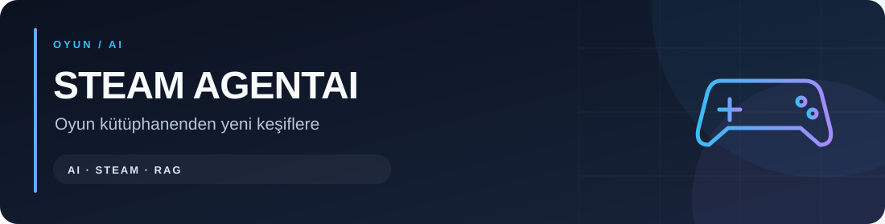
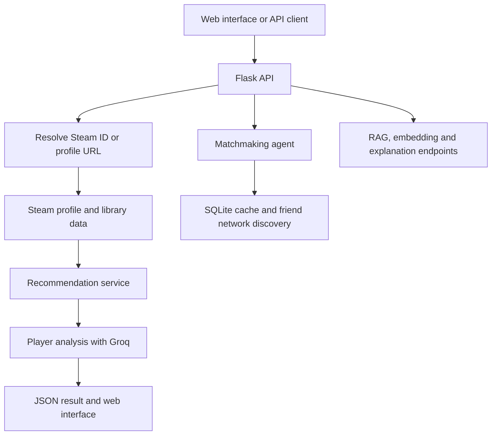

# Steam AgentAI



[](https://github.com/symNistaken/steam-agentai/actions/workflows/checks.yml)
[](https://www.python.org/downloads/)

[](LICENSE)

**Build a player profile from your Steam library, get AI-powered game recommendations and discover similar players.**

Steam AgentAI combines Steam Web API data, language model analysis through Groq and a Python/Flask web interface. The project also includes a multi-agent infrastructure, embedding-based similarity, RAG context and recommendation explanation components.

> This project is not developed or endorsed by Valve, Steam or Groq. Steam and related trademarks belong to their respective owners.

## Contents

- [Features](#features)
- [How it works](#how-it-works)
- [Tech stack](#tech-stack)
- [Installation](#installation)
- [Usage](#usage)
- [Configuration](#configuration)
- [API guide](#api-guide)
- [Project structure](#project-structure)
- [Data and privacy](#data-and-privacy)
- [Tests](#tests)
- [Troubleshooting](#troubleshooting)
- [Current limitations](#current-limitations)
- [Contributing](#contributing)
- [License](#license)

## Features

| Component | What it does |
| --- | --- |
| Profile analysis | Processes the Steam profile, library and playtime. |
| AI recommendations | Generates game recommendations and reasons from player data with Groq. |
| Web interface | Shows profile, library and recommendation results in a Turkish-language interface. |
| Matchmaking | Searches for compatible players using cached players and friend network discovery. |
| Semantic similarity | Compares games by converting their text into embedding vectors. |
| RAG context | Builds context by retrieving similar games from a vector index. |
| Recommendation explanation | Produces explanations based on features such as genre, play style, difficulty and length. |
| Agent infrastructure | Includes profile, retrieval, ranker and matchmaking agents plus coordination code. |

## How it works

Main profile analysis flow:



In the current version, `/api/analyze` and `/api/agentic/recommend` run through `AgenticRecommendationService.analyze_profile()`. Four agents are registered at startup, but these two endpoints do not run the full `Orchestrator` chain on every request. Matchmaking runs its own agent; RAG and explanation features are also available through separate endpoints.

## Tech stack

| Area | Technology |
| --- | --- |
| Language and web | Python 3.10, Flask |
| AI service | Groq SDK; current model: `qwen/qwen3.8-27b` |
| Steam access | Steam Web API, requests, aiohttp |
| Data models | Pydantic |
| Embedding | SentenceTransformers, Transformers, PyTorch |
| Vector search | FAISS; NumPy-based fallback if the package is missing |
| Storage | SQLite and file-based storage components |
| Interface | HTML, CSS and JavaScript |
| Automated checks | GitHub Actions, compileall, unittest |

Package versions are pinned in [requirements.txt](requirements.txt). That file also lists LangChain, Redis, LIME and SHAP; the main application code does not actively use all of them. The explanation component currently does feature-based calculations and should not be read as a real LIME/SHAP analysis.

## Installation

### Requirements

- Python **3.10** and Git.
- A Steam Web API key.
- A Groq API key with access to the configured model.
- An internet connection for package installation, Steam/Groq requests and the first model download.

A GPU is not required. Loading the embedding model needs a download, disk space and memory; how long it takes depends on your system.

### 1. Clone the repository

```bash
git clone https://github.com/symNistaken/steam-agentai.git
cd steam-agentai
```

### 2. Virtual environment and packages

**Windows PowerShell:**

```powershell
py -3.10 -m venv .venv
.\.venv\Scripts\python.exe -m pip install --upgrade pip
.\.venv\Scripts\python.exe -m pip install -r requirements.txt
Copy-Item .env.example .env
```

These commands work without activating the virtual environment, so you don't need to change the PowerShell script execution policy.

**Linux/macOS:**

```bash
python3.10 -m venv .venv
.venv/bin/python -m pip install --upgrade pip
.venv/bin/python -m pip install -r requirements.txt
cp .env.example .env
```

### 3. API keys

Get your own keys from [Steam Web API](https://steamcommunity.com/dev/apikey) and [Groq Console](https://console.groq.com/keys). Edit the `.env` file:

```dotenv
STEAM_API_KEY=YOUR_STEAM_API_KEY
GROQ_API_KEY=YOUR_GROQ_API_KEY
FLASK_DEBUG=false
FLASK_HOST=127.0.0.1
LLM_MODEL=qwen/qwen3.8-27b
```

The keys in the example are placeholders. Keep real keys in `.env`; never put them in issues, screenshots or commits. Each service's access rules and usage quotas also apply.

### 4. Start

Windows:

```powershell
.\.venv\Scripts\python.exe app.py
```

Linux/macOS:

```bash
.venv/bin/python app.py
```

Open **[http://localhost:5000](http://localhost:5000)** in your browser. Keep the terminal open; press `Ctrl+C` to stop the server.

## Usage

1. Enter a Steam ID64, a Steam profile URL or a resolvable custom profile name in the web interface.
2. Start the analysis. Profile and library visibility determine what data can be fetched from Steam.
3. Review the player info, playtime and recommendation reasons.
4. Use matchmaking to search for players with similar libraries.

Groq output can vary between requests. If the AI service fails, the result is marked `analysis.source=fallback` and the interface shows a fallback-method warning. Recommendation reasons, game names and store matches are not guaranteed to be accurate.

## Configuration

| Setting | Location | Behavior |
| --- | --- | --- |
| `STEAM_API_KEY` | `.env` | Steam Web API key |
| `GROQ_API_KEY` | `.env` | Groq key |
| `FLASK_DEBUG` | `.env` | `false` in the example file; the code default is `false` if unset |
| `FLASK_HOST` | `.env` | Default `127.0.0.1` |
| `FLASK_PORT` | `config.py` | Fixed at `5000`; not read from `.env` |
| `LLM_MODEL` | `.env` / `config.py` | Groq model name; default `qwen/qwen3.8-27b` |
| `LLM_PROVIDER` | `config.py` | The current main service uses Groq |
| Embedding model | `core/embeddings.py` | Default `all-MiniLM-L6-v2` |

`config.py` also contains Ollama settings, but the main recommendation service has no completed provider switch, so changing `LLM_PROVIDER` alone is not enough.

## API guide

Base URL: `http://localhost:5000`. Use `Content-Type: application/json` for POST requests.

| Path | Method | Body fields | What it does |
| --- | --- | --- | --- |
| `/` | GET | — | Web interface |
| `/api/analyze` | POST | `steam_input`, optional `use_agentic` | Profile and library analysis |
| `/api/agentic/recommend` | POST | `steam_id` | Recommendation service |
| `/api/health` | GET | — | Agent, tool and database status |
| `/api/db/stats` | GET | — | Cache statistics |
| `/api/matchmaking` | POST | `steam_id` | Player matchmaking |
| `/api/rag/context` | POST | `steam_id`, optional `max_context` | Similar-game context |
| `/api/xai/explain` | POST | `steam_id`, `game_name`, optional `recommendation_score` | Feature-based explanation |
| `/api/embeddings/similarity` | POST | `game1_name`, `game2_name` | Text similarity between two game names |

`use_agentic` defaults to `true`; `max_context` defaults to `15` and is clamped to `1–50`. `recommendation_score` defaults to `0.7`.

In the current code, `/api/agentic/recommend` does not read the `max_recommendations` and `include_matchmaking` fields. Use the separate endpoint for matchmaking.

### PowerShell examples

Health check:

```powershell
Invoke-RestMethod -Uri 'http://localhost:5000/api/health'
```

Profile analysis:

```powershell
$payload = @{ steam_input = 'YOUR_STEAM_ID64'; use_agentic = $true } | ConvertTo-Json
Invoke-RestMethod -Uri 'http://localhost:5000/api/analyze' -Method Post -ContentType 'application/json' -Body $payload
```

Matchmaking:

```powershell
$payload = @{ steam_id = 'YOUR_STEAM_ID64' } | ConvertTo-Json
Invoke-RestMethod -Uri 'http://localhost:5000/api/matchmaking' -Method Post -ContentType 'application/json' -Body $payload
```

### Bash/cURL examples

```bash
curl http://localhost:5000/api/health

curl -X POST http://localhost:5000/api/agentic/recommend \
  -H 'Content-Type: application/json' \
  -d '{"steam_id":"YOUR_STEAM_ID64"}'

curl -X POST http://localhost:5000/api/rag/context \
  -H 'Content-Type: application/json' \
  -d '{"steam_id":"YOUR_STEAM_ID64","max_context":10}'

curl -X POST http://localhost:5000/api/xai/explain \
  -H 'Content-Type: application/json' \
  -d '{"steam_id":"YOUR_STEAM_ID64","game_name":"Elden Ring","recommendation_score":0.85}'

curl -X POST http://localhost:5000/api/embeddings/similarity \
  -H 'Content-Type: application/json' \
  -d '{"game1_name":"Dark Souls 3","game2_name":"Elden Ring"}'
```

Replace `YOUR_STEAM_ID64` in the examples with your own ID. A successful profile analysis returns the `success`, `player`, `stats`, `top_games`, `library` and `analysis` fields. The health endpoint includes the `status`, `agents_registered`, `tools_registered` and `database` fields.

Missing or unresolvable profile input usually returns HTTP `400`; unexpected server errors return `500`. Error responses contain `success: false` and `error`. A successful `/api/health` result does not by itself prove that live Steam/Groq calls or all AI components work.

## Project structure

```text
steam-agentai/
├── app.py                   # Flask and API endpoints
├── config.py                # Environment and model settings
├── init_app.py              # Agent/tool registration
├── orchestrator.py          # Agent coordination infrastructure
├── agents/                  # Profile, retrieval, ranker, matchmaking
├── core/                    # Embedding, vector search, explanation
├── services/                # Steam, Groq, RAG and recommendation services
├── schemas/                 # Pydantic data models
├── tools/                   # Steam tools and schemas
├── database/                # SQLite and file storage code
├── templates/               # Web interface
├── backups/                 # Backup of the previous interface
├── docs/                    # Previous README
├── tests/                   # Standalone SQLite tests
├── .github/workflows/       # GitHub Actions
├── .env.example             # Environment template without keys
├── requirements.txt         # Pinned dependencies
└── LICENSE                  # MIT license
```

## Data and privacy

- `.env`, `.venv/`, `venv/`, Python caches and personal editor settings are ignored by Git.
- `database/matchmaking_cache.db` is the user cache and is not committed. Its schema is created on first use.
- `data/` holds file-based runtime data and is not committed.
- The SQLite cache drops unplayed games and stores the 50 most-played games per player.
- A fresh clone has no ready-made player pool; matchmaking results depend on visible profiles and discovered players.
- Data such as the profile name and played games may be sent to Groq for AI analysis. Profile lookups may also appear in the application terminal.

Review the terms and data processing policies of the third-party services used. Do not load saved vector indexes from untrusted sources; the index storage code uses pickle.

## Tests

With Python 3.10, from the repository root:

```bash
python -m compileall -q app.py config.py init_app.py orchestrator.py agents core database schemas services tools
python -m pip install -r requirements-test.txt
python -m unittest discover -s tests -v
```

The checks use the packages in `requirements-test.txt` and need no API key. If the full model packages are missing, they run with hash embedding/NumPy fallbacks. If local model packages are installed, the first model load may need internet access; set `HF_HUB_OFFLINE=1` for a model that is already downloaded. If you haven't activated the virtual environment, use the `.venv` Python path for your platform instead of `python`.

| Check | Scope |
| --- | --- |
| Syntax | Python sources compile |
| Database test | Empty SQLite schema, persistent records, updates and unique user records |
| API and RAG tests | Invalid input, fallback detection and keeping profile libraries separate |
| Cache test | Dropping unplayed games, a 50-game limit and sorting by playtime |

[GitHub Actions](https://github.com/symNistaken/steam-agentai/actions) runs these checks on push and pull request events. Passing CI does not mean live API integration, dependency installation on every platform or model loading has been tested.

## Troubleshooting

| Problem | What to check |
| --- | --- |
| `ModuleNotFoundError` | Install packages with the Python of the virtual environment you run the app with. |
| Dependency installation fails | Use Python 3.10 and an up-to-date pip; check the package/version compatibility in the error message. |
| Profile or games not found | Check the Steam ID and the visibility of profile/game details. |
| Groq request fails | Check the key, model access, quota and service status. |
| First run is slow | The embedding model may be downloading/loading; check the terminal output. |
| No matchmaking results | The player cache may be empty or the friend network may be unreachable. |
| Port 5000 is in use | Close the other application or change the port in `config.py`. |
| Changed an environment setting but nothing happened | Stop and restart the Flask application. |

When the SentenceTransformers package is missing, the code can use a local hashing embedding fallback. Its results do not match the semantic quality of a trained model. If the package is installed but model loading fails, an automatic fallback is not guaranteed.

## Current limitations

- This is a local development application; production deployment and end-to-end verification are not considered complete.
- It should not be exposed to the internet without API authentication and rate limiting. Production use needs a proper WSGI server and HTTPS.
- The Groq model and pinned package versions may need updates over time.
- The RAG endpoint builds a separate index for each request and uses the player's top 50 games; the full Steam catalog is not available.
- Game name similarity does not guarantee actual gameplay similarity.
- The XAI endpoint fills some game features with default values; its explanations are not verified causal model explanations.

## Contributing

You can report bugs or suggestions through [Issues](https://github.com/symNistaken/steam-agentai/issues).

1. Fork the repository and create a branch for your change.
2. Make the change in the relevant component; add a suitable check if behavior changes.
3. Run the syntax and database checks above.
4. Open a pull request explaining what changed and how you verified it.

Do not include API keys, the user database or personal data in bug reports.

### Other documents

- [Project summary](PROJECT_SUMMARY.md) (Turkish)
- [Presentation notes](SUNUM_NOTLARI.md) (Turkish)
- [Previous README](docs/README-original.md) (Turkish)

These documents keep past development notes. Old performance figures, test results and production-readiness claims have not been re-verified. The `test_suite.py` and `TEST_DOCUMENTATION.md` files mentioned in the previous README are not in the source folder. Use this README as the reference for current setup and behavior.

## License

This project is released under the **[MIT License](LICENSE)**. Commercial use, modification and distribution are allowed; the copyright notice and license text must be kept. The software is provided without warranty.

Copyright (c) 2026 Berkay Seyman. Third-party packages, models, Steam assets and services are subject to their own licenses and terms.

## Last verification

On 14 October 2026, the real Steam API, a Groq recommendation call, SentenceTransformer/FAISS loading, embedding similarity and the explanation endpoint were run. Because the test profile's library was private, the live RAG request returned the expected `400`; RAG indexing and profile separation were tested automatically with sample libraries. CI does not make live API calls. This check is not a guarantee for other accounts, quotas or future model access.
